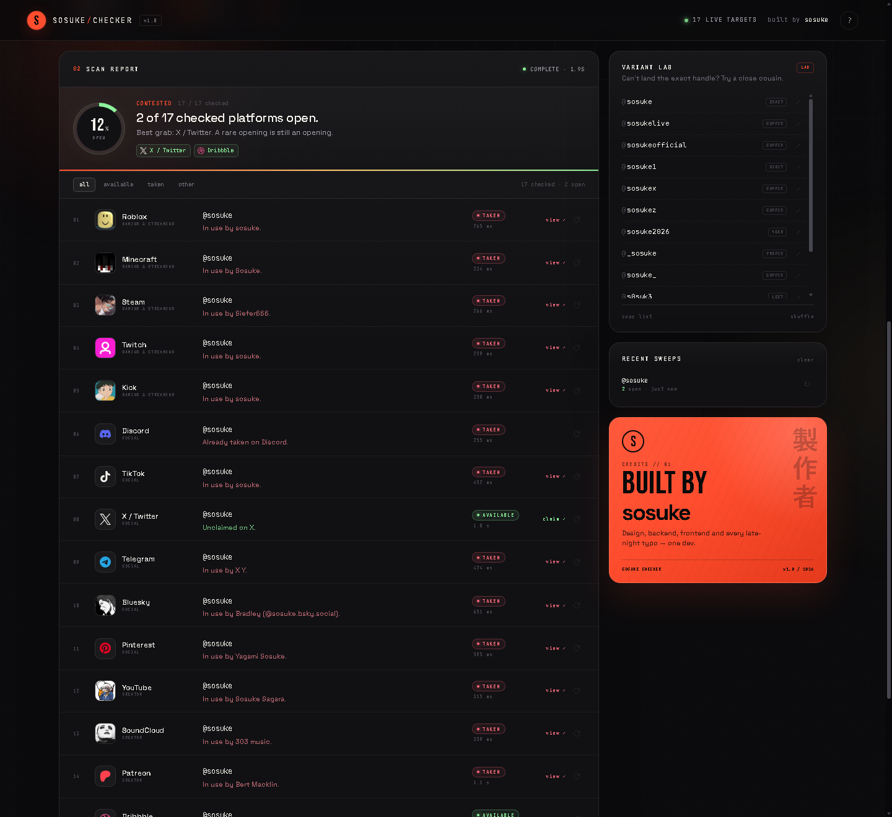
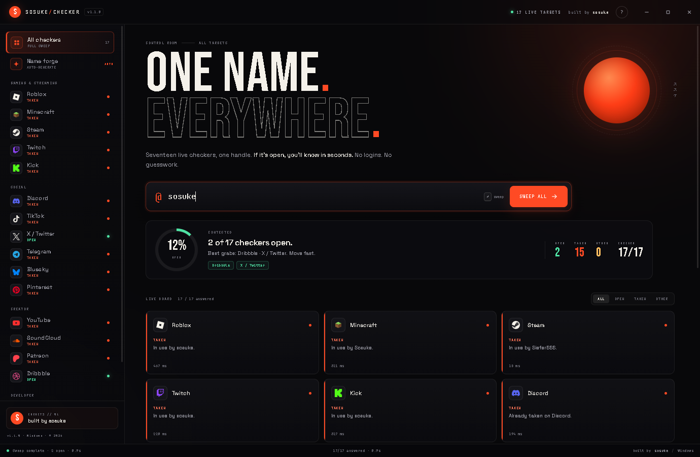
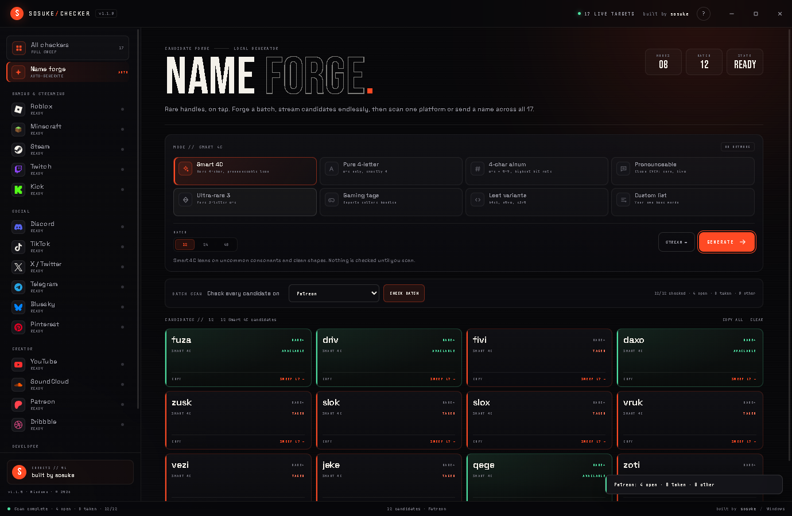

# SOSUKE CHECKER

**One name. Everywhere.**

A local username availability checker that sweeps one handle across **17 platforms** at once — Discord, Roblox, Minecraft, TikTok, YouTube, X/Twitter, Twitch, Kick, Steam, Telegram, Bluesky, Pinterest, SoundCloud, Patreon, Dribbble, GitHub and GitLab — with a local **Name forge** for finding rare handles worth checking.

Real lookups. Live status. No logins, no API keys, no account creation, no tracking.

Ships as a **desktop app for macOS and Windows** and as a local **web app**.

**Built by sosuke.**



---

## Desktop app

The desktop edition is a native Electron app. Each of the 17 checkers gets its own sidebar tab, with an **All checkers** board that sweeps every target in parallel and streams results in live. It also includes the **Name forge**, a local candidate generator for when you need a fresh handle to test.



### macOS

Download `SOSUKE-Checker-1.1.0-universal.dmg`, open it, and drag **SOSUKE Checker** into **Applications**. The DMG is universal — it runs natively on both Apple Silicon and Intel Macs.

The app is **ad-hoc signed** so it runs on Apple Silicon, but it is **not notarized with an Apple Developer ID**, so Gatekeeper will ask for confirmation the first time:

1. Right-click (or Control-click) **SOSUKE Checker** in Applications and choose **Open**.
2. Or open **System Settings → Privacy & Security** and choose **Open Anyway**.
3. Or clear the download flag once:

```bash
xattr -dr com.apple.quarantine "/Applications/SOSUKE Checker.app"
```

After the first launch macOS remembers the app.

### Windows

Download `SOSUKE-Checker-1.1.0-portable.exe` and run it. It is a single portable executable — no installer, no admin rights.

### Name forge

The Name forge is a local generator built into the desktop app. It builds batches of candidates, can stream them endlessly, and then checks a batch on one platform or sends a single name through all 17. Generation never touches the network, and every candidate is filtered for length, allowed characters and unsafe strings before it reaches the board.



| Mode | What it forges | Examples |
|---|---|---|
| **Smart 4C** | Rare four-character names with an unusual consonant and a readable shape. | `zuro`, `qiva`, `vrok` |
| **Pure 4-letter** | Exactly four letters, a–z only. | `hyke`, `fmov` |
| **4-char alnum** | Four characters with at least one letter and one digit. | `z2rh`, `is4f` |
| **Pronounceable** | Strict CVCV — easy to say, easy to remember. | `kiva`, `zuro` |
| **Ultra-rare 3** | Pure three-letter names. Only 17,576 exist. | `qev`, `vuz` |
| **Gaming tags** | Esports bases with digits, prefixes or suffixes. | `clutchgod`, `fragtv` |
| **Leet variants** | Classic words rebuilt with numbers. | `h4ck`, `n0va`, `z3r0` |
| **Custom list** | Your own base words, plus leet and suffix variants. | `sosuke` → `s0suke`, `sosukehq` |

Workflow:

1. Pick a mode and a batch size (12, 24 or 48), then **Generate** — or **Stream** to keep adding candidates.
2. Choose a platform in **Batch scan** and hit **Check batch**. Statuses land on the cards: green open, vermilion taken, amber anything else.
3. Click a name to copy it, or **Sweep 17** to send that one handle through every checker.
4. **Copy all** puts the whole batch on the clipboard.

Name forge settings — mode, batch size, target and custom seed — are remembered between launches. Candidate cards are deliberately not persisted.

### Build the desktop app yourself

```bash
npm install
npm run app        # launch the app from source
npm run dist:mac   # macOS: universal DMG + ZIP in release/
npm run dist:win   # Windows: portable .exe in release/
```

`npm run dist:mac` must run on macOS. It uses `hdiutil`, `sips` and `iconutil`, which do not exist on Windows or Linux. To produce the same ad-hoc signed build locally, run `npm run dist:mac -- -c.mac.identity=-`. The GitHub Actions workflow in [`.github/workflows/build-macos.yml`](.github/workflows/build-macos.yml) does it for you on a `macos-latest` runner: open the **Actions** tab, pick **Build macOS DMG**, and run the workflow. The universal `.dmg` and `.zip` come out as downloadable artifacts after about 5–10 minutes.

### Optional: sign and notarize

The default build is ad-hoc signed and not notarized. If you have an Apple Developer account, add these repository secrets and re-run the workflow; electron-builder will sign with the hardened runtime and notarize automatically:

| Secret | What it is |
|---|---|
| `MAC_CERTIFICATE` | Base64 of your **Developer ID Application** `.p12` |
| `MAC_CERTIFICATE_PASSWORD` | Password for that `.p12` |
| `APPLE_ID` | Apple ID email used for notarization |
| `APPLE_APP_SPECIFIC_PASSWORD` | App-specific password for that Apple ID |
| `APPLE_TEAM_ID` | Your Apple Developer Team ID |

Create the base64 file on a Mac with:

```bash
base64 -i DeveloperID.p12 -o certificate-base64.txt
```

---

## Run the web app

You need **Node.js 18 or newer**. There is nothing to install — the project has zero npm dependencies.

```bash
cd sosuke-checker
node server.js
```

Open **http://127.0.0.1:7331**.

`npm start` also works, but if PowerShell blocks npm scripts with an execution-policy error, just use `node server.js` like above.

### Optional settings

| Variable | Default | What it does |
|---|---|---|
| `PORT` | `7331` | Change the local port. |
| `HOST` | `127.0.0.1` | Set to `0.0.0.0` to allow other devices on your LAN. |
| `GITHUB_TOKEN` | unset | Raises the GitHub API limit from 60 to 5,000 checks/hour. |

PowerShell example:

```powershell
$env:PORT = "8080"
node server.js
```

---

## What it checks

| Platform | How the answer is fetched | Notes |
|---|---|---|
| **Roblox** | Roblox signup availability endpoint | No account created. Avatar and display name added when taken. |
| **Minecraft** | Mojang Java profile API | Java Edition names only. Avatar via mc-heads. |
| **Steam** | Public vanity URL XML | Custom URLs only, not every Steam account. |
| **Twitch** | Twitch public GraphQL | Read-only user lookup. |
| **Kick** | Public channel API | Returns channel name and avatar. |
| **Discord** | Public signup username-availability endpoint | The same check the signup flow uses. Discord has no public profile-by-handle page, so no profile link. |
| **TikTok** | Public oEmbed profile card + page status | Confirms against the profile page so private accounts are not reported free. |
| **X / Twitter** | Public `x.com/@handle` page, FxTwitter as fallback | Free handles 404. No X login needed. |
| **Telegram** | Public `t.me` page | Covers users, channels and groups. |
| **Bluesky** | AT Protocol public handle resolver | Checks the default `@name.bsky.social` handle. Custom-domain handles are not checked. |
| **Pinterest** | Public profile page | Uses the profile title. Pinterest is the slowest target (often 1–2s). |
| **YouTube** | Public `@handle` page | Free handles return HTTP 404. |
| **SoundCloud** | Public profile page | Vanity URL check. |
| **Patreon** | Public creator page | Creator URL check. |
| **Dribbble** | Public profile page | Profile URL check. |
| **GitHub** | GitHub REST API | 60 checks/hour anonymously; set `GITHUB_TOKEN` for more. |
| **GitLab** | GitLab public users API | Read-only lookup. |

## Features

- **One sweep, 17 platforms.** Every check starts in parallel and streams into the report as it answers.
- **Desktop sidebar.** One tab per checker plus an **All checkers** board, so a single platform is always one click away.
- **Name forge (desktop).** Eight local generation modes — smart 4C, pure 3–4 letter, alphanumeric, pronounceable, gaming, leet and custom — with endless streaming, batch scans, copy-all and one-click 17-platform sweeps.
- **Live target board.** All 17 result cards update in place as each endpoint answers, with filters for open, taken and other.
- **Dedicated checker panels.** Each platform tab has its own input, result card, fresh re-check toggle and recent activity list.
- **Honest statuses.** `AVAILABLE`, `TAKEN`, `UNKNOWN`, `INVALID`, `LIMITED` and `ERROR` are kept separate. The tool never turns a blocked lookup into a fake "available".
- **Fresh re-check.** Bypass the cache with the **Fresh** toggle in a checker tab.
- **90-second cache.** Repeated scans are fast and polite; the UI tells you when a result came from cache.
- **Variant lab (web).** Generates close cousins (`_name`, `itsname`, `namehq`, leet versions, etc.). Click any variant to copy it or sweep it.
- **Local history.** The last eight checks per platform stay on your machine — browser storage on the web, app storage on the desktop.
- **Filters and verdicts.** Filter by available/taken/other and get a live "open percentage" plus best grabs.
- **Reports (web).** Copy open handles, export JSON or CSV, or share a link that re-runs the scan.
- **Responsive.** The web app works down to 320px wide; the desktop window scales from 1040×680 upward.
- **Keyboard.** `Enter` runs the focused checker, `Cmd/Ctrl+K` jumps to the active input, `Alt+↑/↓` cycles tabs (including Name forge), `Esc` stops a sweep, batch scan or stream and closes the manual.

## Why some platforms are missing

Instagram, Reddit, Xbox, PlayStation, Snapchat and Facebook are intentionally **not** listed. They require a logged-in session, an API key, or get past a bot wall before they will answer. A checker that guesses would be worse than one that is honest about its coverage.

If a platform is not included, the reason is access — not a forgotten line of code.

## Caveats worth knowing

- **Availability is not a reservation.** A name can be claimed seconds after a green result. Move fast.
- **Rate limits happen.** Roblox, Discord and GitHub throttle. A `LIMITED` row means the platform asked us to slow down; wait a minute and hit that row's refresh.
- **Some answers are heuristics.** Pinterest uses the profile page title. Steam checks custom URLs, not every account. Minecraft checks Java names. Bluesky checks the default `.bsky.social` handle.
- **Discord's endpoint is unofficial.** It is the public availability check used by the signup flow. No account is created, but Discord can change or throttle it at any time.
- **X/Twitter reads the public profile page** and only falls back to FxTwitter, a third-party public API, if X serves an unreadable layout. X's own API requires auth.
- **No server storage.** Scans, history and selection stay on your machine. The server only keeps a short in-memory cache; the desktop app keeps history in its own local storage.
- **Respect the platforms.** Use this for personal checks, keep the built-in rate limit on, and do not hammer endpoints.

## How it works

### Desktop app

```
Renderer (electron/ui/, sandboxed)
   │  window.sosuke bridge
   ▼
Preload (electron/preload.js)
   │  IPC
   ▼
Main process (electron/main.js)
   │  validate → cache → adapter
   ▼
lib/engine.js + lib/platforms.js
   │
   ▼
Platform APIs and public pages
```

The renderer runs with `contextIsolation`, `sandbox` and a strict CSP: no Node, no direct network access. Every lookup goes through the main process, which reuses the same adapters as the web edition. Name forge generation also runs in the main process (`lib/generator.js`) and never touches the network.

### Web app

```
Browser (public/)
   │  one POST per platform, streamed
   ▼
Node server (server.js)
   │  validate → cache → adapter
   ▼
lib/engine.js + lib/platforms.js
   │
   ▼
Platform APIs and public pages
```

- `server.js` — static file server + JSON API + per-IP rate limit + security headers.
- `electron/main.js` — desktop window, menu, IPC, macOS lifecycle and navigation guards.
- `electron/preload.js` — frozen, minimal bridge exposed as `window.sosuke`.
- `electron/ui/` — the desktop interface: `index.html`, `styles.css`, `app.js`, bundled icons and fonts.
- `build/` — app icon, DMG background artwork and macOS entitlements.
- `lib/platforms.js` — 17 adapters, each returning a normalized result.
- `lib/engine.js` — username normalization, validation, caching, timeouts.
- `lib/generator.js` — local Name forge: eight modes, safety filter, de-duplication.
- `lib/http.js` — tiny fetch/timeout/HTML helpers.
- `public/` — the web interface: `index.html`, `styles.css`, `app.js`, bundled brand icons.

Endpoints:

```text
GET  /api/health
GET  /api/platforms
POST /api/check   { "platform": "roblox", "username": "sosuke", "fresh": false }
```

## Credits

**Built by sosuke.** Concept, design, frontend, backend, desktop app, testing — the whole thing.

Brand marks in `public/icons/` and `electron/ui/icons/` come from [Simple Icons](https://simpleicons.org/) (CC0). Interface fonts are Bebas Neue, Space Grotesk and JetBrains Mono (SIL Open Font License). All platform names, logos and trademarks belong to their respective owners. This project is not affiliated with or endorsed by any platform it checks.

## License

MIT © 2026 **sosuke**. See [LICENSE](LICENSE).
